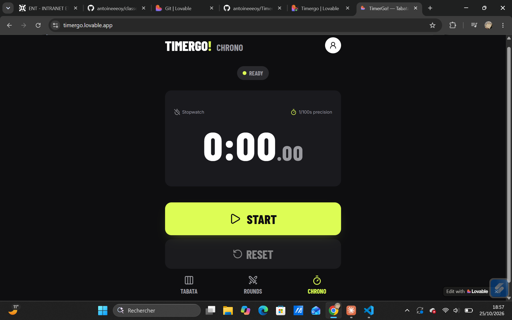
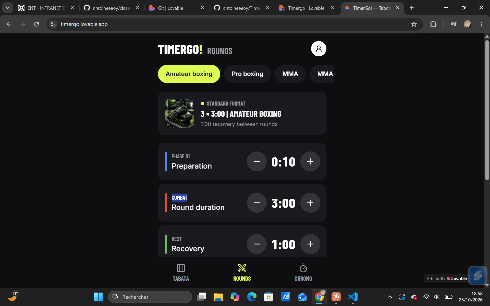
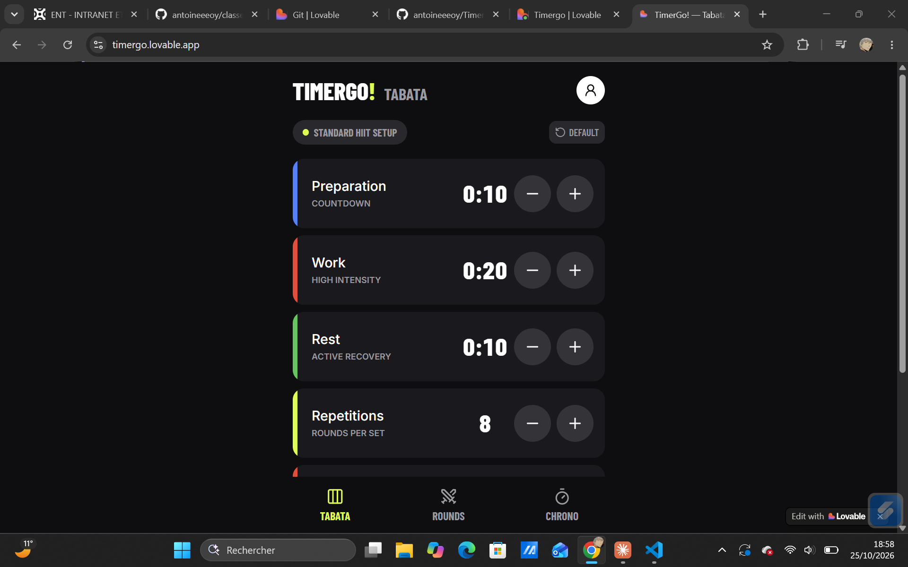
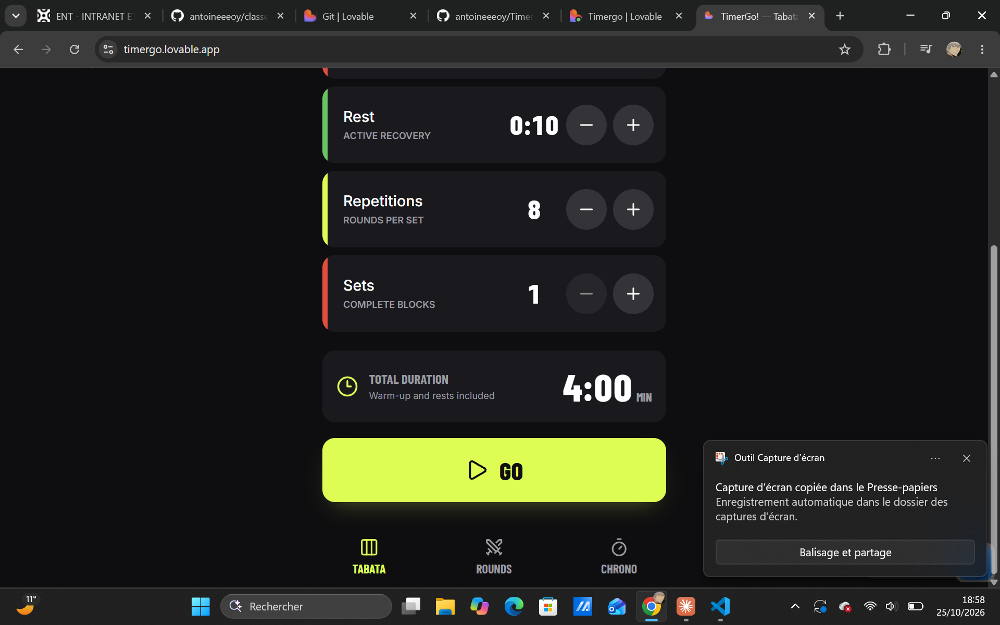

# TimerGo!

Minuteur sportif pour l'entraînement : intervalles Tabata, rounds de boxe et de MMA, et chronomètre.

**Essayer l'application : https://timergo.lovable.app**






## Fonctionnalités

- **Tabata** : temps de préparation, de travail et de récupération, nombre de répétitions et de séries, avec la durée totale de la séance calculée automatiquement.
- **Rounds de combat** : enchaînement de rounds et de temps de repos, pour la boxe ou le MMA.
- **Chronomètre** classique.

## Technologies

- React et TypeScript
- Vite
- TanStack Router
- Tailwind CSS et composants shadcn/ui
- Vitest pour les tests

## Comment il a été réalisé

TimerGo! a été conçu avec [Lovable](https://lovable.dev), un outil de création d'applications assisté par l'intelligence artificielle. J'ai défini les fonctionnalités et l'interface, puis fait évoluer l'application étape par étape. Ce projet m'a permis de découvrir l'écosystème React et TypeScript.

## Lancer le projet sur son ordinateur

Il faut [Node.js](https://nodejs.org) installé.

```bash
git clone https://github.com/antoineeeoy/TimerGo.git
cd TimerGo
npm install
npm run dev
```

L'application s'ouvre ensuite à l'adresse indiquée dans le terminal.

## Auteur

Antoine USO CHEA, étudiant en L3 Informatique à l'Université Gustave Eiffel.
